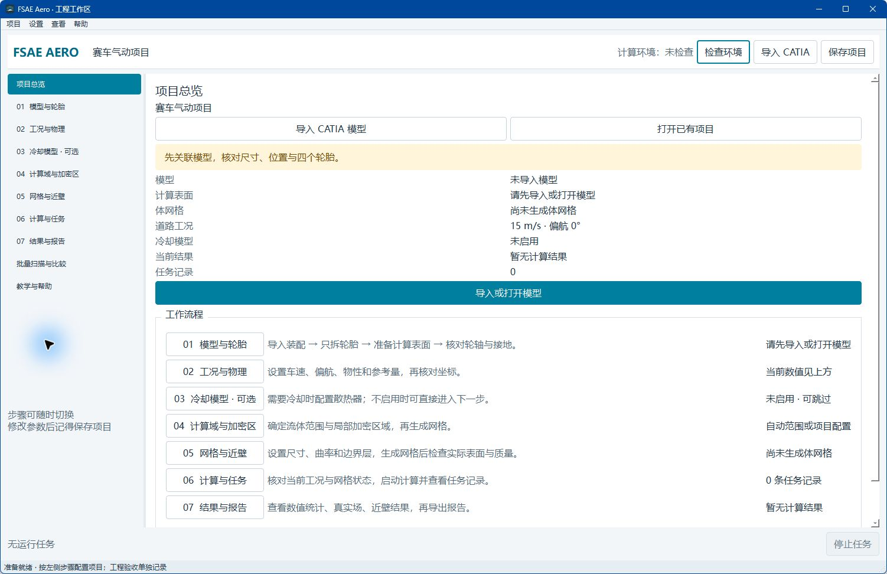

# FSAE Aero

面向 Formula Student / FSAE 的 Windows 原生气动计算软件。

**[下载软件](https://github.com/z10-01z/fsae-aero/releases)** · [开始使用](docs/QUICK_START.md) · [使用说明](docs/USER_GUIDE.md) · [反馈问题](https://github.com/z10-01z/fsae-aero/issues/new)

支持 CATIA V5 R20 装配导入、只提取轮胎、计算域与加密区设置、OpenFOAM 网格与求解、工况扫描、可配置空气侧冷却以及场数据和报告查看。

当前为 **预览版**。实际工程质量取决于输入几何、网格、近壁、收敛及敏感性检查；尚不提供实车绝对精度保证。冷却模型需要使用者提供实际参数。

下载 Release 中的 Windows ZIP，完整解压后运行 `FSAE_Aero.exe`。GitHub 的“Source code”压缩包仅包含本仓库的公开说明，不包含应用源码或可执行程序。

## 环境

- Windows 64 位；大模型建议至少32GB内存，实际需求随网格与并行数变化。
- 基本项目和报告操作不要求安装 CATIA 或 WSL。
- 原生 CATPart/CATProduct 导入需要本机已安装、可用的 CATIA V5 R20。
- 网格及计算需要 WSL2、Ubuntu 和 OpenCFD OpenFOAM v2512；这些外部软件不随本包提供。
- 公开版 CAD 检查采用 OpenCASCADE/OCP；不包含 Gmsh。

## 下载与反馈

每次 Release 提供 ZIP 与 SHA256 校验值。校验方法见开始使用说明。请在 Issues 填写版本、操作步骤和预期/实际行为；分享前检查截图和日志，移除个人路径、项目数据和凭证。不要上传原始车型、整套计算结果或敏感文件。

本仓库只承载软件发布、公开说明和问题反馈。软件授权见 [LICENSE](LICENSE.md)，第三方组件声明见 [THIRD_PARTY_NOTICES](THIRD_PARTY_NOTICES.md)。
